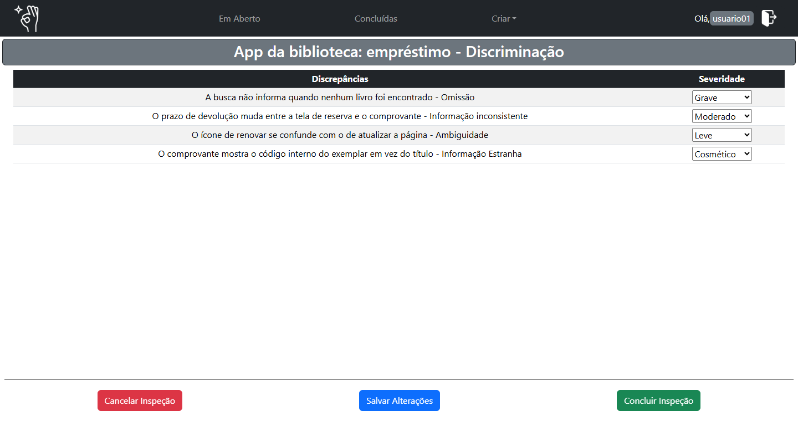

# Inspecável

A web tool for running usability inspections as a team, from setup to the final report. A moderator opens the inspection and invites inspectors; each inspector records the issues they find; the moderator merges duplicates, rates severity and exports the result as a PDF.

An academic project built in 2024 at the Federal University of Amazonas (UFAM), Brazil, with Python and Django. The interface, code identifiers and documentation are in Portuguese.

*[Versão em português](README.md)* · [Documentation and user guide (Portuguese)](https://filipedibr.github.io/Inspecavel/)



## The problem

A usability inspection is carried out by specialists who assess an interface against defined criteria. It works, but it depends on a disciplined process: inspectors work separately so they do not influence each other, and the moderator consolidates everything without steering the assessment. Run through spreadsheets and chat, the process gets lost in duplicate findings, inconsistent naming and skipped steps.

Inspecável walks the inspection through the method's four stages in order: the inspection list takes each person to the current stage, a closed detection stage accepts no new findings, and a completed inspection can no longer be edited.

## How it works

| Stage | Who | What happens |
|---|---|---|
| **Planning** | Moderator | Creates the inspection: title, artefact under review, link, deadline and inspectors. |
| **Detection** | Inspectors | Each one records the issues they find (location, description and type) without seeing the others'. The moderator sees how many each inspector has recorded and closes the stage. |
| **Collection** | Moderator | Groups the findings that describe the same problem, picking one as the main entry. |
| **Discrimination** | Moderator | Rates the severity of each consolidated finding and completes the inspection. |

Once complete, the report is exported as a PDF with the location, description, author, type and severity of each finding. The moderator can cancel the inspection at any stage.

**Criteria are configurable.** An *artefact* defines how locations are named (for example "Screen" and "Element"), which defect types exist and which severity scale applies. The usability-inspection standard ships by default, and any user can add another.

**Roles are per inspection.** Whoever creates an inspection moderates it and can be an inspector in another one.

## Stack

Python and Django (class-based views, built-in auth, custom user model), SQLite, Django templates with Bootstrap, ReportLab for the PDF, and MkDocs Material for the documentation site on GitHub Pages.

## Running it locally

Requires Python 3.12 or newer (tested with Python 3.13 and Django 6.1).

```bash
git clone https://github.com/FIlIpeDiBr/Inspecavel.git
cd Inspecavel
python -m venv .venv
source .venv/bin/activate          # Windows: .venv\Scripts\activate
pip install -r requirements.txt

export DJANGO_SECRET_KEY="any-local-value"
python manage.py migrate
python manage.py runserver
```

Open <http://127.0.0.1:8000>. The migrations create four demo accounts, `usuario01` to `usuario04`, whose password equals the username.

Session and CSRF cookies are marked secure: login works on `127.0.0.1` without HTTPS, but not on other addresses served over HTTP, such as the machine's LAN IP.

## Known limitations

- There are no automated tests.
- Access control stops at login: the stage screens do not check whether the visitor is the moderator or an inspector of that inspection.
- The settings are for development (`DEBUG` on, any host allowed, an admin account created by a migration). The project is not ready to be deployed.
- The "filtered issues" panel on the collection screen stays empty: the view does not pass that list to the template.
- The interface is deliberately plain: the priority was the inspection workflow, as the documentation explains.

## Authors

Filipe Dias Brandão · [github.com/FIlIpeDiBr](https://github.com/FIlIpeDiBr)

Waleson Melo · [github.com/waleson-melo](https://github.com/waleson-melo)
