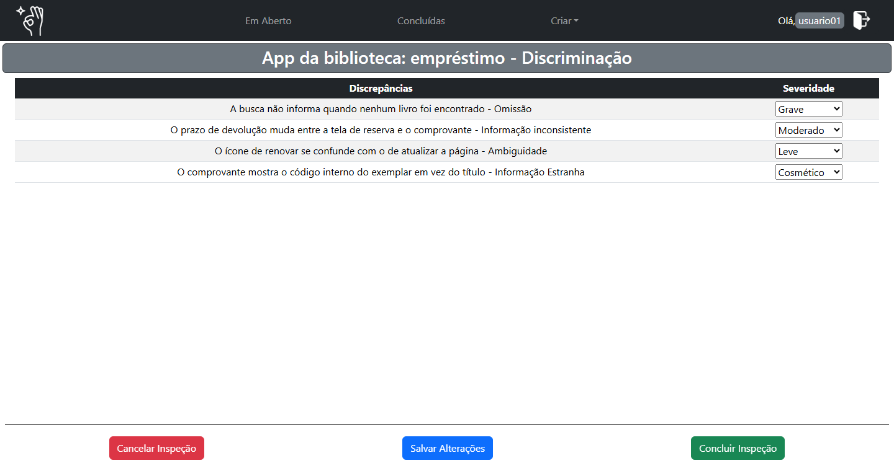
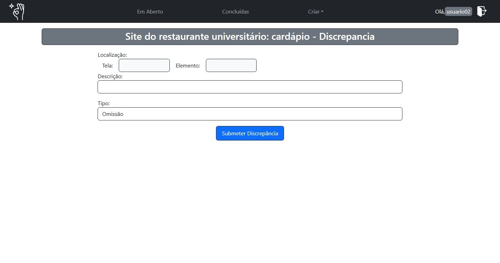
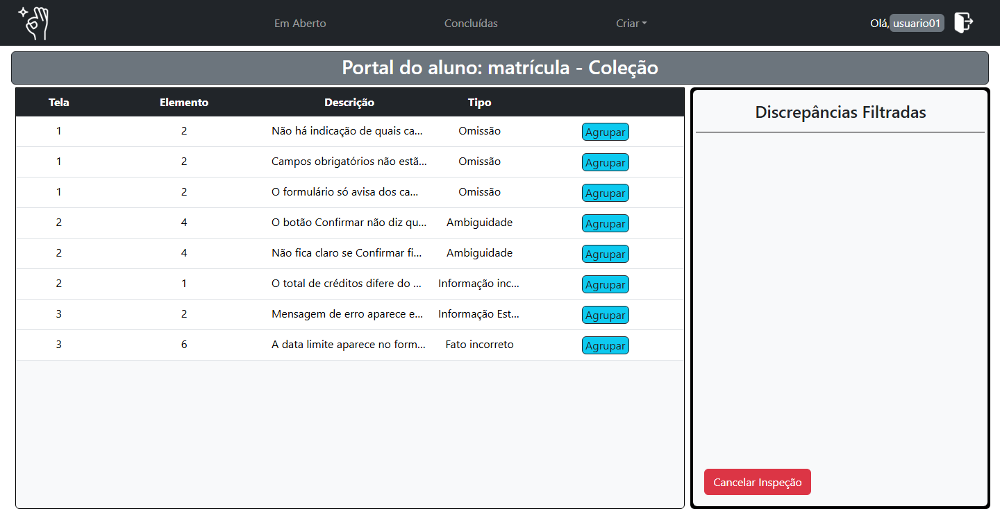

# Inspecável

Ferramenta web para conduzir inspeções de usabilidade em equipe, da criação ao relatório final. Um monitor abre a inspeção e convida inspetores; cada inspetor registra as discrepâncias que encontra; o monitor junta as repetidas, classifica a severidade e exporta o resultado em PDF.

Projeto acadêmico desenvolvido em 2024 na Universidade Federal do Amazonas (UFAM), com Python e Django.

*[English version](README.en.md)* · [Documentação e guia de uso](https://filipedibr.github.io/Inspecavel/)



## O problema

A inspeção de usabilidade é feita por especialistas, que avaliam uma interface contra critérios definidos. Funciona bem, mas depende de um processo disciplinado: os inspetores trabalham em separado para não influenciar uns aos outros, e o monitor consolida tudo sem interferir na avaliação. Feito com planilhas e mensagens, o processo se perde em discrepâncias duplicadas, nomenclaturas diferentes e etapas puladas.

O Inspecável conduz a inspeção pelas quatro etapas do método, na ordem: a lista de inspeções leva cada pessoa à etapa em que a inspeção está, a detecção encerrada não recebe mais registros e a inspeção concluída fica fechada para edição.

## Como funciona

| Etapa | Quem | O que acontece |
|---|---|---|
| **Planejamento** | Monitor | Cria a inspeção: título, artefato a avaliar, link, prazo e inspetores. |
| **Detecção** | Inspetores | Cada um registra as discrepâncias que encontra (localização, descrição e tipo), sem ver as dos outros. O monitor acompanha quantas cada inspetor registrou e encerra a etapa. |
| **Coleção** | Monitor | Agrupa as discrepâncias que descrevem o mesmo problema, escolhendo uma como principal. |
| **Discriminação** | Monitor | Atribui a severidade de cada discrepância consolidada e conclui a inspeção. |

Concluída a inspeção, o relatório sai em PDF com localização, descrição, autor, tipo e severidade de cada discrepância. O monitor pode cancelar a inspeção em qualquer etapa.

**Os critérios são configuráveis.** Um *artefato* define como a inspeção nomeia as localizações (por exemplo, "Tela" e "Elemento"), quais tipos de defeito existem e qual a escala de severidade. O sistema já vem com o padrão da inspeção de usabilidade (tipos como omissão, ambiguidade e fato incorreto; severidade de "não defeito" a "catastrófico"), e qualquer usuário pode cadastrar outro.

**O papel é por inspeção.** Quem cria uma inspeção é o monitor dela e pode ser inspetor em outra. Não há cadastro de perfis fixos.

| Detecção (inspetor) | Coleção (monitor) |
|---|---|
|  |  |

## Tecnologias

| Camada | Tecnologia |
|---|---|
| Aplicação | Python, Django (views baseadas em classe, autenticação nativa, usuário customizado) |
| Banco de dados | SQLite, com migrações que criam o artefato padrão e usuários de demonstração |
| Interface | Templates Django e Bootstrap |
| Relatório | ReportLab (geração do PDF) |
| Documentação | MkDocs Material, publicada no GitHub Pages |

## Estrutura

Cada parte do domínio é um app Django:

| App | Responsabilidade |
|---|---|
| `inspecao` | Criação da inspeção e listas de inspeções em aberto e concluídas |
| `artefato` | Padrões de inspeção: nomenclaturas, tipos de defeito e escala de severidade |
| `discrepancia` | Detecção, coleção, discriminação e exportação do PDF |
| `discrepancia_filtrada` | Discrepância consolidada: a principal, as repetidas e a severidade |
| `usuario` | Usuário customizado, cadastro, login e edição de perfil |

## Rodando localmente

Pré-requisito: Python 3.12 ou mais novo (testado com Python 3.13 e Django 6.1).

```bash
git clone https://github.com/FIlIpeDiBr/Inspecavel.git
cd Inspecavel
python -m venv .venv
source .venv/bin/activate          # Windows: .venv\Scripts\activate
pip install -r requirements.txt

export DJANGO_SECRET_KEY="qualquer-valor-local"   # PowerShell: $env:DJANGO_SECRET_KEY="qualquer-valor-local"
python manage.py migrate
python manage.py runserver
```

Abra <http://127.0.0.1:8000>. As migrações criam quatro contas de demonstração, `usuario01` a `usuario04`, com a senha igual ao nome de usuário, para testar a inspeção com um monitor e vários inspetores.

Os cookies de sessão e de CSRF estão marcados como seguros: o login funciona em `127.0.0.1` sem HTTPS, mas não em outro endereço servido por HTTP, como o IP da máquina na rede local.

## Limitações conhecidas

- Não há testes automatizados.
- O acesso é controlado só pelo login: as telas de cada etapa não conferem se quem as abre é o monitor ou um inspetor daquela inspeção.
- A configuração é de desenvolvimento (`DEBUG` ligado, qualquer host aceito, conta de administrador criada pela migração). O projeto não está pronto para ser publicado em um servidor.
- O painel "Discrepâncias filtradas" da tela de coleção fica vazio: a view não envia essa lista ao template.
- A interface é simples por escolha: a prioridade foi o fluxo da inspeção, como registrado na documentação.

## Autores

Filipe Dias Brandão · [github.com/FIlIpeDiBr](https://github.com/FIlIpeDiBr)

Waleson Melo · [github.com/waleson-melo](https://github.com/waleson-melo)
